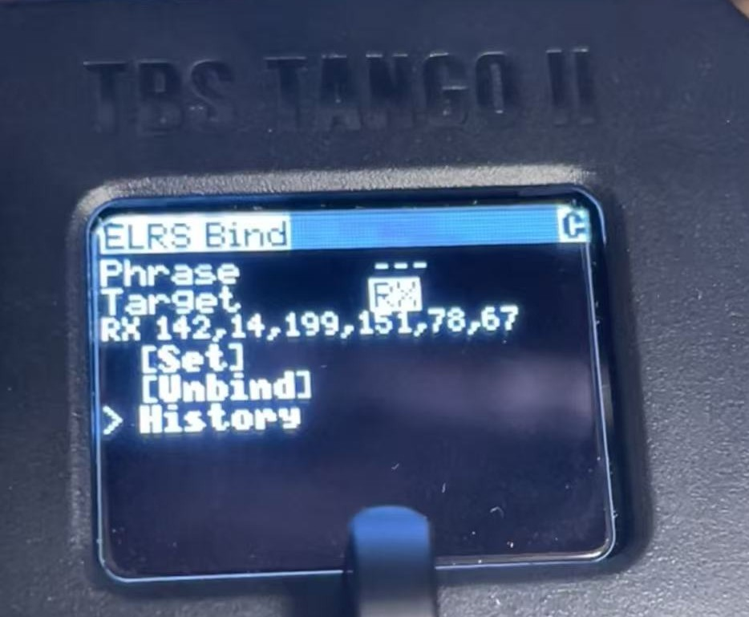
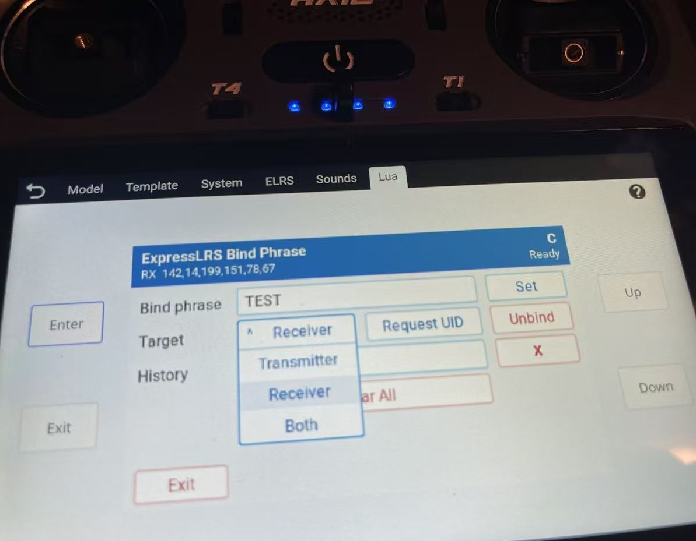

# ExpressLRS Bind Phrase Manager

This repository contains two **UNOFFICIAL** Lua scripts for managing ExpressLRS bind phrases and receiver UIDs on radio systems outside the EdgeTX versions officially supported by the upstream ExpressLRS Lua tools.

These scripts are an unofficial, independent adaptation. They are not part of, endorsed by, or maintained by the official ExpressLRS project as Lua tools. The source files are based on ExpressLRS project source files and this repository uses the same GPL-3.0-only license as the official ExpressLRS Lua repository.

## Versions

| Version | Source | Precompiled | Display | Tested on |
| --- | --- | --- | --- | --- |
| Black-and-white | [`src/bw/elrs-bind.lua`](src/bw/elrs-bind.lua) | [`src/bw/elrs-bind.luac`](src/bw/elrs-bind.luac) | Black-and-white LCD, including 128×96 | TBS Mambo, TBS Tango 2 |
| Color | [`src/color/elrs-bind.lua`](src/color/elrs-bind.lua) | [`src/color/elrs-bind.luac`](src/color/elrs-bind.luac) | Color LCD | RadioMaster app on AX12 |

The black-and-white version has been tested on a TBS Mambo and TBS Tango 2. The color version has been tested in the RadioMaster app on AX12. These are the tested setups; compatibility with other radios or firmware versions may vary.

## In Use

**Black-and-white version on TBS Tango 2**

**Color version in the RadioMaster app on AX12**

## Features

Both versions communicate with ExpressLRS devices over MSP carried by CRSF telemetry. They can read the UID, set a bind phrase or UID on the transmitter, receiver, or both, and keep up to five recent phrases in `/SCRIPTS/TOOLS/elrs-history.txt` on the radio. The color version also provides receiver bind and unbind controls.

## Compatibility

The official ExpressLRS Lua tools support EdgeTX 2.11.6+, 2.12.1+, or 3.0+ on both black-and-white and color LCD radios. This unofficial script is intended for systems outside that support range and requires ExpressLRS 4.1 or later on the target device. See the [official ExpressLRS Lua README](https://github.com/ExpressLRS/Lua/blob/master/README.md) for the upstream requirements.

## Installation

Copy the matching `.lua` script to the radio's scripts directory and launch it through the radio firmware's Lua tool interface. Create `/SCRIPTS/TOOLS/` on the radio if it does not already exist so phrase history can be saved. `/AX12LUA/SCRIPTS/TOOLS/` on RadioMaster AX12.

If the black-and-white script runs out of memory on a TBS radio, use the bundled precompiled version, [`src/bw/elrs-bind.luac`](src/bw/elrs-bind.luac), instead of the `.lua` source file.

## License

This project is licensed under the GNU General Public License v3.0 (GPL-3.0-only), matching the [official ExpressLRS Lua repository](https://github.com/ExpressLRS/Lua/blob/master/LICENSE). See the [full GPL-3.0 license text](https://www.gnu.org/licenses/gpl-3.0.html).
